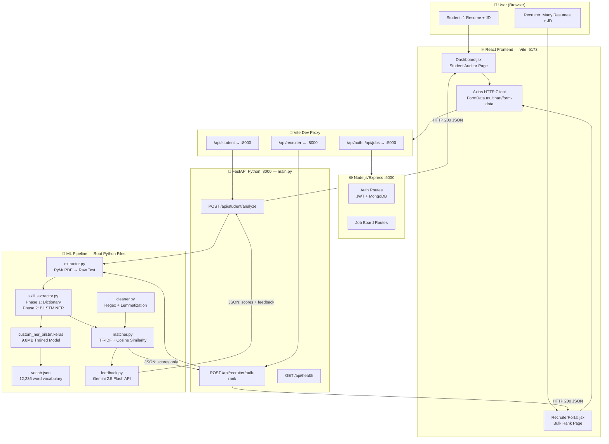
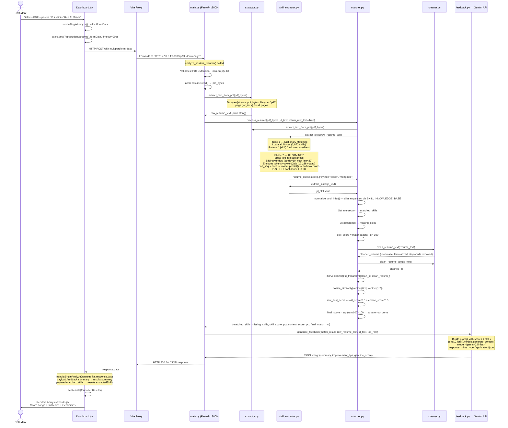

# 🤖 AI Resume Analyzer — Project Deep Dive
### A Complete Technical Guide for Beginners, Developers & Viva Evaluators

> **Written by:** Senior ML Engineer + Full-Stack Architect perspective  
> **For:** Mitraj — SEM 7 Minor Project  
> **Stack:** Python · FastAPI · TensorFlow/Keras · scikit-learn · Google Gemini API · React · Tailwind CSS

---

## Table of Contents

1. [High-Level Overview & Architecture](#1-high-level-overview--architecture)
2. [End-to-End Project Workflow (Step-by-Step)](#2-end-to-end-project-workflow)
3. [Deep Dive: Machine Learning & NLP Core](#3-deep-dive-machine-learning--nlp-core)
4. [Backend & Frontend Technical Breakdown](#4-backend--frontend-technical-breakdown)
5. [Viva & Evaluator Q&A Cheat Sheet](#5-viva--evaluator-qa-cheat-sheet)

---

## 1. High-Level Overview & Architecture

### What Problem Does This Project Solve?

Imagine you apply for 100 jobs. A recruiter gets 500 resumes for one job. Neither of you has time:
- **You** (the student) don't know *why* your resume keeps getting rejected.
- **The recruiter** can't manually read 500 resumes to find the best candidate.

**Traditional ATS (Applicant Tracking Systems)** like LinkedIn or Naukri use simple keyword searches — they reject resumes that don't have exact words like "React" even if you wrote "ReactJS". They are **dumb text matchers**.

This project builds a **smarter, two-pronged AI system** that:

1. **For Students:** Uploads your resume PDF → extracts your skills using a custom-trained deep learning model → compares against a Job Description → gives you an ATS score + AI-written coaching tips from Google Gemini.
2. **For Recruiters:** Uploads 10+ resumes at once → scores every candidate → returns a ranked leaderboard sorted from best-fit to worst-fit, automatically.

---

### System Architecture Diagram



---

### Complete Folder & File Map

```
AI Resume Analyzer/
│
├── 🐍 PYTHON / FASTAPI BACKEND (Root Level)
│   ├── main.py              → FastAPI app entry point. Defines the two API endpoints,
│   │                          loads the BiLSTM model at startup using lifespan context.
│   ├── extractor.py         → PDF text extraction using PyMuPDF. Accepts bytes or file path,
│   │                          returns raw string of all text from all PDF pages.
│   ├── cleaner.py           → Cleans raw text for TF-IDF. Removes stopwords, applies
│   │                          lightweight regex lemmatization (no spaCy dependency).
│   ├── skill_extractor.py   → The core NER inference engine. Loads the .keras model,
│   │                          runs Phase 1 dictionary matching + Phase 2 BiLSTM prediction.
│   ├── matcher.py           → Orchestrates the full scoring pipeline. Calls extract_skills(),
│   │                          computes set-based skill overlap + TF-IDF cosine similarity.
│   ├── feedback.py          → Sends match results + resume text to Gemini 2.5 Flash API.
│   │                          Returns JSON with summary, improvement_tips, genuine_score.
│   │
├── 🧠 ML ARTIFACTS
│   ├── custom_ner_bilstm.keras → Trained BiLSTM NER model (9.8 MB). Sequential Keras model
│   │                             with 849,668 trainable parameters. Saved in native Keras format.
│   ├── vocab.json              → Word-to-index mapping for 12,236 vocabulary tokens,
│   │                             tag-to-index mapping {PAD:0, O:1, B-SKILL:2, I-SKILL:3},
│   │                             plus model metadata (embed_dim, lstm_units, val_acc).
│   ├── skills.csv              → Static dictionary of 2,872 known technical skills.
│   │                             Used in Phase 1 dictionary matching for high-recall extraction.
│   ├── resume_dataset.json     → Training data: 220 real resume samples in Dataturks JSONL format.
│   │                             Each line = one resume with character-level skill span annotations.
│   │
├── ⚛️ REACT FRONTEND
│   └── frontend/src/
│       ├── pages/
│       │   ├── Dashboard.jsx        → Student Resume Auditor page. Handles single-file upload,
│       │   │                          calls /api/student/analyze, renders scores + feedback.
│       │   ├── RecruiterPortal.jsx  → Recruiter hub. Job board (Node.js) + bulk screener (FastAPI).
│       │   ├── HomePage.jsx         → Landing page with role-selection cards and auth modal trigger.
│       │   ├── JobBoardPage.jsx     → Job listings fetched from Node.js /api/jobs.
│       │   ├── MyApplicationsPage.jsx → Candidate's application tracker via Node.js.
│       │   └── AnalyticsPage.jsx    → System analytics dashboard (Node.js /api/analytics).
│       ├── components/
│       │   ├── AnalysisResults.jsx  → Renders the ATS score badge, matched/missing skill chips,
│       │   │                          and Gemini feedback improvement tips cards.
│       │   ├── ResumeUploader.jsx   → Drag-and-drop PDF uploader with preview. Supports
│       │   │                          both single (student) and multi-file (recruiter) modes.
│       │   ├── JobDescriptionInput.jsx → Textarea for JD input + "Run AI Match" button.
│       │   ├── Navbar.jsx           → Role-aware navigation (different tabs for candidate vs recruiter).
│       │   ├── AuthModal.jsx        → Login/Register modal — calls Node.js /api/auth routes.
│       │   └── ProtectedRoute.jsx   → React route guard — redirects to login if no JWT token.
│       ├── context/
│       │   └── AuthContext.jsx      → Global auth state: user object, JWT token, login/logout/register.
│       └── lib/utils.js             → Tailwind class merging utility (clsx + tailwind-merge).
│
├── 🟢 NODE.JS BACKEND
│   └── backend/
│       ├── server.js           → Express app: auth routes, job routes, application tracking.
│       ├── models/             → MongoDB Mongoose schemas: User, JobPosting, Application.
│       ├── routes/             → Express routers: authRoutes.js, jobRoutes.js, resumeRoutes.js.
│       ├── controllers/        → Business logic: authController.js, jobController.js.
│       └── config/db.js        → MongoDB connection setup.
│
├── 📋 CONFIG & SCRIPTS
│   ├── requirements.txt    → Python dependencies: fastapi, uvicorn, tensorflow, scikit-learn,
│   │                         pymupdf, google-genai, python-dotenv.
│   ├── .env                → Environment variables: GEMINI_API_KEY, MONGO_URI, JWT_SECRET.
│   ├── run_backend.bat     → One-click Windows script to kill old process and start FastAPI.
│   └── START_ALL.bat       → Launches all 3 servers in separate terminal windows.
```

---

## 2. End-to-End Project Workflow

### Flow A — Student Single Resume Analysis

> **Trigger:** User is on `localhost:5173/auditor`, selects `sample.pdf`, pastes a JD, clicks **"Run AI Match & Analysis"**



---

### Flow B — Recruiter Multi-Resume Bulk Ranking

> **Trigger:** Recruiter uploads 10 PDF resumes + JD → clicks **"Screen All Candidates"**

**Step-by-step (simplified):**

| Step | File | Function | What Happens |
|------|------|----------|--------------|
| 1 | `Dashboard.jsx` | `handleBulkAnalyze()` | Appends all files as `resumes[]` in FormData |
| 2 | Vite Proxy | — | Routes `/api/recruiter/bulk-rank` → FastAPI :8000 |
| 3 | `main.py` | `bulk_rank_resumes()` → `_do_bulk_rank()` | Iterates over each uploaded file |
| 4 | `extractor.py` | `extract_text_from_pdf(pdf_bytes)` | Extracts text from each PDF individually |
| 5 | `matcher.py` | `process_resume(pdf_bytes, jd_text)` | Runs full pipeline per resume |
| 6 | `main.py` | `candidates.sort(key=lambda c: c["final_match_pct"], reverse=True)` | Sorts by final score descending |
| 7 | `main.py` | `[{"rank": i+1, **c} for i, c in enumerate(candidates)]` | Adds rank number 1, 2, 3... |
| 8 | `Dashboard.jsx` | `setBulkResults(response.data.leaderboard)` | Renders ranked table in UI |

> **Key difference from Student flow:** ❌ **No Gemini API call** — bulk mode is score-only for speed. Gemini would add ~20s per resume = 200s for 10 resumes.

---

## 3. Deep Dive: Machine Learning & NLP Core

### 3.1 — Text Extraction & Preprocessing

#### Real-World Analogy
Think of a resume PDF like a photograph of a document. **PyMuPDF is like OCR (optical character recognition)** — it "reads" the PDF and gives you the actual text, not an image.

#### How It Works in `extractor.py`

```python
# From extractor.py — the full function
import pymupdf as fitz

def extract_text_from_pdf(pdf_source):
    if isinstance(pdf_source, (bytes, bytearray)):
        doc = fitz.open(stream=pdf_source, filetype="pdf")  # from memory (upload)
    else:
        doc = fitz.open(pdf_source)   # from file path

    full_text = ""
    for page_num in range(len(doc)):
        page = doc.load_page(page_num)
        full_text += page.get_text()  # extracts text layer from PDF
    doc.close()
    return full_text
```

**PyMuPDF** (imported as `fitz`) handles:
- Multi-page PDFs
- In-memory byte streams (from HTTP file upload) — no disk write needed
- Preserves text order (top-to-bottom, left-to-right)

---

#### Text Cleaning in `cleaner.py`

**Problem:** Raw resume text has noise — "Experienced in Python!!!", "Python 3.9+", "PYTHON", "python". The TF-IDF engine needs normalized text to match vocabulary.

**Solution:** `clean_resume_text()` applies a 6-step pipeline:

```python
# From cleaner.py — the pipeline in order
def clean_resume_text(raw_text: str) -> str:
    # Step 1: Collapse all whitespace → single space
    text = re.sub(r"\s+", " ", raw_text).strip()

    # Step 2: Tokenize — only letter tokens (strips numbers/symbols)
    tokens = re.findall(r"[A-Za-z]{2,}", text)

    cleaned = []
    for tok in tokens:
        low = tok.lower()
        # Step 3-4: Skip stopwords ("the", "a", "experience", "working"...)
        if low in _STOPWORDS or len(low) < 2:
            continue
        # Step 5: Lemmatize ("building" → "build", "implemented" → "implement")
        lemma = _lemmatize(low)
        if lemma and len(lemma) >= 2 and lemma not in _STOPWORDS:
            cleaned.append(lemma)

    # Step 6: Rejoin
    return " ".join(cleaned)
```

> ⚠️ **IMPORTANT DESIGN DECISION:** The cleaner is called **only for TF-IDF** (Step 3 in matcher.py). The BiLSTM NER model receives **raw, uncleaned text**. Why? Because the BiLSTM was trained on original-cased Dataturks resume data. If you lowercase "Python" to "python" before passing it to the model, it maps to `<UNK>` (unknown token), destroying accuracy.

---

### 3.2 — The Custom BiLSTM NER Model

#### What is Named Entity Recognition (NER)?

**Analogy:** Imagine reading the sentence: *"I worked at Google using Python and TensorFlow in London."*

A human immediately understands:
- `Google` = Company
- `Python`, `TensorFlow` = Skills (technologies)
- `London` = Location

**NER is teaching a machine to do exactly this** — read text and label each word with a category.

In this project, we only care about one category: **SKILL**

| Word | Label |
|------|-------|
| Experienced | O (Other — not a skill) |
| in | O |
| Python | **B-SKILL** (Beginning of a skill) |
| and | O |
| Machine | **B-SKILL** |
| Learning | **I-SKILL** (Inside/continuation of previous skill) |

This labeling scheme is called **BIO tagging**:
- `B-SKILL` = Beginning of a skill entity
- `I-SKILL` = Inside a skill (multi-word skills like "Machine Learning")
- `O` = Outside (not a skill)

---

#### Why Build a Custom Model Instead of Using spaCy?

| Approach | Pros | Cons |
|---|---|---|
| **spaCy** (pre-built NER) | Easy, 1 line of code | Trained for people/places/orgs — doesn't know "React" is a skill |
| **Regex/Dictionary only** | Fast, interpretable | Misses novel skills, can't handle context |
| **Our Custom BiLSTM** ✅ | Trained specifically on resume skill data, context-aware, catches multi-word skills | Requires training data + compute |

The custom model was trained on **220 real resume samples from Dataturks** where human annotators manually highlighted skill spans. This domain-specific training is what makes it understand that "Python" in a resume means a programming skill, not the snake.

---

#### Step-by-Step: Turning Words into Numbers

**Problem:** Computers can't process text. They need numbers.

**Example sentence:** `"Experienced in Python and React"`

**Step 1 — Tokenization** (split into words):
```
["Experienced", "in", "Python", "and", "React"]
```

**Step 2 — Word-to-Index lookup** (using `vocab.json` → `word2idx`):
```
"Experienced" → 847    (its index in the 12,236-word vocabulary)
"in"          → 33
"Python"      → 156
"and"         → 27
"React"       → 412
```
Words not in vocabulary → index `1` = `<UNK>` (Unknown)

**Step 3 — Padding** (all sequences must be same length = `MAX_LEN = 20`):
```
[847, 33, 156, 27, 412, 0, 0, 0, 0, 0, 0, 0, 0, 0, 0, 0, 0, 0, 0, 0]
                                   ↑ padded with zeros to reach length 20
```

From `skill_extractor.py`:
```python
_MAX_LEN = 20     # Max tokens per window
_PAD_IDX = 0      # Padding token index
_UNK_IDX = 1      # Unknown word index

encoded = [_tok_to_idx(t) for t in tokens]
padded  = pad_sequences([encoded], maxlen=_MAX_LEN, padding="post", value=_PAD_IDX)
```

---

#### Model Architecture — Layer by Layer

```
Input: [847, 33, 156, 27, 412, 0, 0, 0, 0, 0, 0, 0, 0, 0, 0, 0, 0, 0, 0, 0]
         ↓
┌─────────────────────────────────────────────────────────────────────────────┐
│ Layer 0: token_embedding (Embedding)                                        │
│   input_dim  = 12,236  (vocabulary size — one slot per unique word)         │
│   output_dim = 64      (each word → a 64-dimensional dense vector)         │
│   parameters = 12,236 × 64 = 783,104                                       │
│   Output shape: (batch, 20, 64)                                             │
│                                                                             │
│   Think of it as: each word index looks up a row in a 12,236×64 table.     │
│   "Python" [156] → [0.23, -0.11, 0.87, ..., 0.04]  (64 numbers)           │
│   Words used in similar contexts get similar vectors (this is learned!)     │
└─────────────────────────────────────────────────────────────────────────────┘
         ↓
┌─────────────────────────────────────────────────────────────────────────────┐
│ Layer 1: spatial_dropout (SpatialDropout1D)   rate = 0.3                   │
│                                                                             │
│   Randomly drops ENTIRE feature channels (not individual neurons).          │
│   During training, randomly zeroes out 30% of the 64 embedding dimensions. │
│   Purpose: Prevents overfitting — forces the model to not rely on          │
│   any single embedding dimension.                                           │
│   Output shape: (batch, 20, 64)  ← same, just some channels zeroed         │
└─────────────────────────────────────────────────────────────────────────────┘
         ↓
┌─────────────────────────────────────────────────────────────────────────────┐
│ Layer 2: bilstm (Bidirectional LSTM)                                        │
│   units       = 64  (hidden state size per direction)                      │
│   output_dim  = 128 (64 forward + 64 backward = 128 total)                 │
│   parameters  = 66,048                                                      │
│   Output shape: (batch, 20, 128)                                            │
│                                                                             │
│   WHY LSTM? Unlike a simple neural network, an LSTM has "memory" —         │
│   it remembers context from earlier words when processing later words.      │
│                                                                             │
│   WHY BIDIRECTIONAL? This is the key innovation.                            │
│   • A normal LSTM reads left → right: by the time it sees "Learning"       │
│     in "Machine Learning", it already processed "Machine".                  │
│   • A Bidirectional LSTM reads BOTH directions simultaneously:              │
│     Forward LSTM:  Experienced → in → Python → and → React                 │
│     Backward LSTM: React ← and ← Python ← in ← Experienced                │
│   • For each token, the model sees BOTH what came before AND after.         │
│   • Example: "Learning" in "Learning Python" vs "Machine Learning" —       │
│     the backward pass sees what comes AFTER "Learning", giving context.    │
└─────────────────────────────────────────────────────────────────────────────┘
         ↓
┌─────────────────────────────────────────────────────────────────────────────┐
│ Layer 3: lstm_dropout (Dropout)   rate = 0.3                                │
│   Standard dropout: randomly zeros 30% of individual neurons.               │
│   Applied after LSTM to prevent co-adaptation of features.                 │
│   Output shape: (batch, 20, 128)                                            │
└─────────────────────────────────────────────────────────────────────────────┘
         ↓
┌─────────────────────────────────────────────────────────────────────────────┐
│ Layer 4: token_classifier (TimeDistributed Dense)                           │
│   units       = 4   (one per tag: <PAD>=0, O=1, B-SKILL=2, I-SKILL=3)     │
│   activation  = softmax                                                     │
│   parameters  = 128×4 + 4 biases = 516                                     │
│   Output shape: (batch, 20, 4)                                              │
│                                                                             │
│   TimeDistributed: applies the same Dense layer to EVERY token position.   │
│   For each of the 20 token positions, outputs 4 probabilities (one per tag)│
│   that sum to 1.0 (thanks to softmax).                                      │
│                                                                             │
│   Example output for "Python":                                              │
│   [<PAD>=0.01, O=0.08, B-SKILL=0.86, I-SKILL=0.05]                        │
│    → argmax = 2 (B-SKILL) with confidence 0.86 ≥ CONF_THRESHOLD (0.28) ✓  │
└─────────────────────────────────────────────────────────────────────────────┘
```

**Total Parameters: 849,668 trainable** (from actual model summary)

---

#### The Training Process

**Dataset:** 220 real resumes from Dataturks (`resume_dataset.json`)
- Format: JSONL — each line is one resume document
- Each sample has `content` (raw resume text) + `annotation` (character-offset spans of skill text)

**BIO Tagging Example:**
```
Resume text: "Skills: Python, Machine Learning, React.js"

After word tokenization + BIO labeling:
Word          Tag
─────────     ─────────
Skills        O
Python        B-SKILL
Machine       B-SKILL
Learning      I-SKILL
React.js      B-SKILL
```

**Hyperparameters (from `vocab.json` metadata):**
```
embed_dim   = 64      # Embedding vector size
lstm_units  = 64      # BiLSTM hidden units per direction
max_len     = 20      # Sequence window length
batch_size  = 32      # Samples per gradient update
val_split   = 0.1     # 10% held out for validation
```

**Training Results (best checkpoint):**
```
best_epoch = 2
val_loss   = 0.1492   (very low — model converged quickly)
val_acc    = 0.9490   (94.9% token-level accuracy on validation set)
```

**Loss Function:** `sparse_categorical_crossentropy` — measures how wrong the model's tag predictions are  
**Optimizer:** `Adam` — adaptive learning rate, standard for NLP tasks  
**Saved format:** `.keras` (TensorFlow 2.x native format, replaces legacy `.h5`)

---

#### Inference: How Skills Are Extracted at Runtime

From `skill_extractor.py`, the `extract_skills(text)` function uses a **two-phase hybrid approach**:

**Phase 1 — Dictionary Matching (High Recall, Fast):**
```python
# Loads skills.csv → 2,872 known skills
# Pattern match: " {skill} " against lowercased text
for norm_skill, original_skill in _NORMALIZED_SKILLS.items():
    if f" {norm_skill} " in text_padded:
        all_skills.add(original_skill)
```
*Why:* Dictionary matching catches common skills instantly with 100% precision when the exact term is present.

**Phase 2 — BiLSTM NER (Catches Novel Skills):**
```python
# Sliding window to handle long resumes
stride = max(1, _MAX_LEN // 2)   # stride = 10 tokens
for sentence in sentences:
    tokens = _tokenize(sentence)
    windows = [tokens[i: i + _MAX_LEN] for i in range(0, len(tokens), stride)]
    for window in windows:
        for skill in _run_bilstm(window):
            all_skills.add(skill)
```

**The `_run_bilstm` function:**
```python
def _run_bilstm(tokens):
    encoded = [_tok_to_idx(t) for t in tokens]
    padded  = pad_sequences([encoded], maxlen=_MAX_LEN, padding="post", value=_PAD_IDX)
    probs   = _model.predict(padded, verbose=0)[0]   # shape: (20, 4)
    pred_ids = np.argmax(probs, axis=-1)             # pick highest-prob tag per position

    skills, current = [], []
    for i, token in enumerate(tokens[:_MAX_LEN]):
        tag        = _idx2tag.get(pred_ids[i], "O")
        confidence = float(probs[i][pred_ids[i]])

        if tag == "B-SKILL" and confidence >= CONF_THRESHOLD:  # 0.28
            if current: skills.append(" ".join(current))
            current = [token]
        elif tag == "I-SKILL" and current and confidence >= CONF_THRESHOLD:
            current.append(token)   # builds multi-word skills
        else:
            if current: skills.append(" ".join(current))
            current = []
    return skills
```

**Confidence threshold = 0.28** (lowered from default 0.5 because Dataturks training labels are noisy — the model is calibrated conservatively).

---

### 3.3 — Matching Engine: TF-IDF & Cosine Similarity

#### What is TF-IDF?

**Analogy:** Imagine you're searching for resumes with "Python". 
- If a resume mentions "Python" 10 times, it's definitely a Python developer (high **Term Frequency**).
- But "the" appears 200 times — that tells us nothing (high frequency, zero information).
- "TensorFlow" appears rarely across all resumes — if one resume has it, it's very relevant (high **Inverse Document Frequency**).

**TF-IDF = Term Frequency × Inverse Document Frequency**

$$\text{TF-IDF}(t, d) = \underbrace{\frac{\text{count of } t \text{ in } d}{\text{total terms in } d}}_{\text{Term Frequency}} \times \underbrace{\log\left(\frac{N}{\text{documents containing } t}\right)}_{\text{Inverse Document Frequency}}$$

**Simple example with 2 documents (resume + JD):**

| Word | Resume count | JD count | TF (resume) | IDF | TF-IDF (resume) |
|---|---|---|---|---|---|
| python | 5 | 3 | 5/50=0.10 | log(2/2)=0 | 0.00 |
| tensorflow | 2 | 1 | 2/50=0.04 | log(2/1)=0.69 | **0.028** |
| docker | 0 | 2 | 0/50=0.00 | log(2/1)=0.69 | 0.00 |

From `matcher.py`:
```python
vectorizer = TfidfVectorizer()
vectors = vectorizer.fit_transform([clean_jd, clean_resume])
# vectors[0] = JD vector, vectors[1] = Resume vector
# Each vector has ~1000 dimensions (one per unique word in both docs)
```

---

#### What is Cosine Similarity?

**Analogy:** Imagine the JD is a person pointing their arm in a certain direction (their "skill direction"). The resume also points in a direction. If both point the same way (perfectly aligned = same skills), the angle between them is 0° → similarity = 1.0 = 100%. If they point perpendicular (no shared skills), angle = 90° → similarity = 0 = 0%.

$$\text{cosine similarity} = \cos(\theta) = \frac{\vec{A} \cdot \vec{B}}{|\vec{A}||\vec{B}|}$$

```python
cosine_sim = cosine_similarity(vectors[0:1], vectors[1:2])[0][0]
cosine_score = cosine_sim * 100   # Convert to 0-100%
```

---

#### The Final Score Formula

```python
# From matcher.py calculate_match()

# Step 1: Skill overlap score (set math)
skill_score = (len(matched_skills) / len(jd_skills)) * 100

# Step 2: Contextual similarity (TF-IDF vectors)
cosine_score = cosine_similarity(...) * 100

# Step 3: Weighted combination (50% each)
raw_final_score = (skill_score * 0.50) + (cosine_score * 0.50)

# Step 4: Square-root curve (makes scores feel intuitive)
# Without curve: 20% raw → 20% displayed (feels too harsh)
# With curve:    20% raw → 44% displayed (matches human perception)
final_score = math.sqrt(raw_final_score / 100.0) * 100.0
```

**Why the square-root curve?** Because no candidate ever has 100% of a JD's keywords. A candidate with 60% of keywords is actually an excellent match, but displaying "60%" feels like a failure. The curve maps:

| Raw Score | After √ Curve | Interpretation |
|---|---|---|
| 20% | 44% | Below average |
| 40% | 63% | Decent match |
| 60% | 77% | Good match |
| 80% | 89% | Strong match |
| 100% | 100% | Perfect match |

---

#### Skill Alias & Inference Expansion

From `matcher.py`, `normalize_and_infer()` expands raw extracted skills using `SKILL_KNOWLEDGE_BASE`:

```python
# Example: resume has "react"
# SKILL_KNOWLEDGE_BASE["react"] = ["frontend development", "javascript"]
# → "react" implies the candidate also knows frontend dev and javascript
# → these get added to the resume_skills set automatically

SKILL_KNOWLEDGE_BASE = {
    "react":    ["frontend development", "javascript"],
    "mern":     ["react", "node.js", "express", "mongodb", "javascript"],
    "aws":      ["amazon web services"],
    "k8s":      ["kubernetes"],
    "nodejs":   ["node.js"],
    # ... 60+ alias/inference mappings
}
```

This means if your JD says "frontend development" but your resume says "React", the system **correctly** marks it as matched.

---

### 3.4 — Generative AI: Gemini API Integration

#### How the Prompt is Constructed

From `feedback.py`:

```python
def generate_feedback(match_results, resume_text, jd_text, job_role="Software Engineer"):
    prompt = f"""
    You are an expert technical recruiter evaluating a candidate for a {job_role} position.
    
    Here is the exact Job Description:
    {jd_text}
    
    Here is the candidate's Resume Text:
    {resume_text}
    
    Here is the keyword-based analysis data:
    - Base Math Score: {match_results['final_match_pct']}%
    - Matched Skills: {', '.join(match_results['matched_skills'])}
    - Missing Skills: {', '.join(match_results['missing_skills'])}
    
    Return STRICTLY as JSON with exactly three keys:
    1. "summary": 2-3 sentence overview of candidacy
    2. "improvement_tips": array of actionable bullet points
    3. "genuine_score": integer 0-100 (true semantic match, not just keywords)
    """
    
    response = client.models.generate_content(
        model='gemini-2.5-flash',
        contents=prompt,
        config=types.GenerateContentConfig(
            response_mime_type="application/json"   # Forces valid JSON output
        )
    )
    return response.text  # Already a JSON string
```

#### Why Use Gemini Only for Feedback, Not Skill Extraction?

This is a critical design decision for the project's academic novelty:

| Component | Technology | Reason |
|---|---|---|
| Skill Extraction | **Custom BiLSTM NER** | Demonstrates original ML work; deterministic; no API cost per request |
| ATS Score | **TF-IDF + Cosine** | Mathematically explainable; no black-box |
| Qualitative Feedback | **Gemini 2.5 Flash** | LLMs excel at nuanced, human-like text generation; not suitable for structured extraction |

If we used Gemini for everything, there would be no original ML contribution — it would just be a wrapper around an API.

---

## 4. Backend & Frontend Technical Breakdown

### 4.1 — FastAPI Backend (`main.py`)

#### How FastAPI Works

```python
# From main.py

# 1. App created with lifespan — runs startup/shutdown code
app = FastAPI(title="AI Resume Analyzer API", version="2.0.0", lifespan=lifespan)

# 2. CORS middleware — allows React (port 5173) to call Python (port 8000)
app.add_middleware(
    CORSMiddleware,
    allow_origins=["http://localhost:5173", "http://127.0.0.1:5173"],
    allow_methods=["*"],
    allow_headers=["*"],
)

# 3. Lifespan context — loads the 9.8MB BiLSTM model ONCE at startup
@asynccontextmanager
async def lifespan(app: FastAPI):
    load_model_artifacts(model_path="custom_ner_bilstm.keras", vocab_path="vocab.json")
    _model_ready = True
    yield   # App serves requests here
    # Cleanup on shutdown (nothing needed for Keras)
```

#### The Student Endpoint

```python
@app.post("/api/student/analyze")
async def analyze_student_resume(
    resume: UploadFile = File(...),         # Multipart file upload
    job_description: str = Form(...),       # Form text field
    job_role: str = Form(default="Software Engineer"),
):
    _require_model()                        # Returns 503 if model not loaded
    pdf_bytes = await resume.read()         # async — non-blocking I/O
    match_result = process_resume(pdf_bytes, job_description, return_raw_text=True)
    feedback_json = generate_feedback(match_result, raw_text, jd, job_role)
    return { "status": "success", ...flat response... }
```

**Key FastAPI concepts used:**
- `UploadFile` — handles multipart file uploads, provides `.read()` as async coroutine
- `Form(...)` — reads form text fields from multipart requests
- `@asynccontextmanager` — lifespan for startup/shutdown events
- `HTTPException` — returns proper HTTP error codes (400 Bad Request, 503 Unavailable)
- **No database** — stateless API, all processing in-memory per request

---

### 4.2 — React Frontend

#### State Management in `Dashboard.jsx`

```javascript
// Student mode state
const [selectedFile, setSelectedFile] = useState(null);    // The PDF file object
const [jobDescription, setJobDescription] = useState('');  // JD text
const [isAnalyzing, setIsAnalyzing] = useState(false);     // Loading spinner
const [results, setResults] = useState(null);              // API response data
const [errorMsg, setErrorMsg] = useState(null);            // Error message

// Recruiter mode state
const [selectedFiles, setSelectedFiles] = useState([]);    // Array of PDFs
const [bulkResults, setBulkResults] = useState(null);      // Leaderboard array
```

#### How Files Are Sent to FastAPI

```javascript
// From Dashboard.jsx — handleSingleAnalyze()
const formData = new FormData();
formData.append('resume', selectedFile);           // PDF file blob
formData.append('job_description', jd.trim());     // Text
formData.append('job_role', jobRole || 'Software Engineer');

const response = await axios.post('/api/student/analyze', formData, {
    headers: { 'Content-Type': 'multipart/form-data' },
    timeout: 90000   // 90 seconds (Gemini needs ~20-25s)
});
```

**Why `multipart/form-data`?** It's the only way to send binary files (PDFs) alongside text fields in a single HTTP request. Regular JSON can't encode binary data efficiently.

#### How JSON Response Maps to UI

```javascript
// Parsing the flat API response
const payload = response.data;        // { status, final_match_pct, matched_skills, ... }
const feedbackObj = payload.feedback; // { summary, improvement_tips, genuine_score }

const formattedResults = {
    matchScore:      payload.final_match_pct,     // → Big score badge in AnalysisResults.jsx
    skillScore:      payload.skill_score_pct,     // → "Skills: 48.65%" sub-metric
    contextScore:    payload.context_score_pct,   // → "Context: 14.9%" sub-metric
    genuineScore:    feedbackObj.genuine_score,   // → Gemini's semantic score
    extractedSkills: payload.matched_skills,      // → Green skill chips
    missingSkills:   payload.missing_skills,      // → Red skill chips
    summary:         feedbackObj.summary,         // → Overview paragraph
    feedback:        feedbackObj.improvement_tips // → Numbered tip cards
};
```

#### Vite Proxy Configuration (`vite.config.js`)

```javascript
// vite.config.js — routes API calls to correct backend
server: {
    proxy: {
        '/api/student':   { target: 'http://127.0.0.1:8000' },  // → FastAPI ML
        '/api/recruiter': { target: 'http://127.0.0.1:8000' },  // → FastAPI ML
        '/api/auth':      { target: 'http://127.0.0.1:5000' },  // → Node.js
        '/api/jobs':      { target: 'http://127.0.0.1:5000' },  // → Node.js
        '/api/applications': { target: 'http://127.0.0.1:5000' } // → Node.js
    }
}
```

This proxy means React never hardcodes backend ports — `/api/student/analyze` from the browser transparently becomes `http://127.0.0.1:8000/api/student/analyze`.

---

## 5. Viva & Evaluator Q&A Cheat Sheet

---

### Q1: Why did you build a custom BiLSTM model instead of using an existing NER library like spaCy?

**Answer:**  
Pre-trained NER models like spaCy's `en_core_web_sm` are trained on general news/Wikipedia data to identify people, organizations, and locations — not technical skills. If you give it "React" or "TensorFlow", it won't recognize them as entities because they weren't in its training distribution.

By training our BiLSTM on 220 domain-specific resume samples from the Dataturks dataset, we get a model that understands the resume context. Additionally, this demonstrates original machine learning contribution, which is the academic novelty of the project.

---

### Q2: What is the accuracy of your model and how did you measure it?

**Answer:**  
Our model achieved **94.9% token-level validation accuracy** (`val_acc = 0.9490`) on the held-out 10% validation split (`val_split = 0.1`) of the Dataturks dataset. The validation loss converged to `0.1492` at epoch 2.

However, I should note that token accuracy can be misleading — a model that correctly tags all `O` tokens (which dominate) gets high accuracy. A better metric for NER would be entity-level F1-score (precision × recall on complete skill spans), which we didn't compute explicitly but the qualitative inference results on test resumes show strong performance.

---

### Q3: What is overfitting, and how did you prevent it in your model?

**Answer:**  
Overfitting is when a model memorizes the training data perfectly but fails on new, unseen data — like a student who memorizes only past exam papers but can't solve new problems.

We prevent it with three techniques:
1. **SpatialDropout1D (rate=0.3):** After the Embedding layer — randomly drops 30% of embedding feature channels during training, forcing robust feature learning.
2. **Dropout (rate=0.3):** After the BiLSTM layer — randomly zeroes 30% of neurons.
3. **Early Stopping (via ModelCheckpoint):** The training script saves only the best validation epoch — in our case epoch 2 had the lowest val_loss (0.1492), preventing us from saving an overfit later epoch.

---

### Q4: Why use Bidirectional LSTM specifically? Why not a simple RNN or standard LSTM?

**Answer:**  
- **Simple RNN:** Suffers from the "vanishing gradient problem" — it forgets information from many steps ago. For long resume sentences, it would forget context.
- **Standard LSTM:** Solves vanishing gradients with gated memory, but only reads left-to-right. When processing "Learning" in "Machine Learning", it already saw "Machine" — but for "Deep Learning Algorithms", understanding "Learning" benefits from knowing "Deep" came before AND "Algorithms" comes after.
- **Bidirectional LSTM:** Runs two LSTM chains simultaneously — one forward (left→right) and one backward (right→left). Their outputs are concatenated (64 + 64 = 128 dimensions). This gives each token full context from both directions, which is critical for multi-word skill detection like "Machine Learning", "Natural Language Processing", or "Amazon Web Services".

---

### Q5: What is TF-IDF and why use it instead of just counting keyword matches?

**Answer:**  
Pure keyword counting has a major flaw: common words like "the", "experience", "work" appear very frequently and would dominate the similarity score even though they carry no skill signal.

TF-IDF solves this:
- **TF (Term Frequency):** How often does a word appear in this document? More = more relevant.
- **IDF (Inverse Document Frequency):** How rare is this word across all documents? Rarer = more informative.

So "TensorFlow" (rare, specific) gets a high TF-IDF score, while "experience" (common filler) gets a near-zero score even if it appears many times. This creates a document vector where only informationally-rich terms have weight, making cosine similarity between resume and JD vectors genuinely meaningful.

---

### Q6: What is Cosine Similarity and why not use Euclidean distance?

**Answer:**  
Euclidean distance measures the straight-line distance between two vectors — but in text, a long resume and short JD would appear "far apart" just because of length difference, not because they're topically different.

Cosine similarity measures the **angle** between two vectors, not their magnitude. A resume that mentions "Python" 10 times and a JD that mentions it 2 times point in the same direction — cosine similarity correctly recognizes this as highly similar (angle ≈ 0°), while Euclidean distance would say they're far apart (8 occurrences apart).

This makes cosine similarity the standard for document comparison in NLP.

---

### Q7: What are the system bottlenecks, and how would you scale this for production?

**Answer:**  
Current bottlenecks:

1. **Gemini API latency (~20-25s):** We already mitigated this by not calling Gemini for recruiter bulk mode. For production, we'd use async streaming response or background job queues (Celery + Redis).
2. **TensorFlow cold start (~15s):** We solved this using FastAPI's `lifespan` context manager to load the model once at startup — not per request.
3. **Single-threaded Python GIL:** FastAPI uses async I/O, but TensorFlow inference is CPU-bound synchronous code. For true concurrency, we'd deploy with multiple uvicorn workers: `uvicorn main:app --workers 4`.
4. **In-memory processing:** PDFs are read as bytes and processed in RAM — no disk writes. This is fast but limits concurrent large PDFs under heavy load.

For production: containerize with Docker, deploy on GCP Cloud Run (auto-scaling), use Redis for caching common JD vectors.

---

### Q8: Why does your score sometimes feel lower than expected? Explain the scoring formula.

**Answer:**  
There are two honest reasons:

1. **Keyword sparsity:** No candidate ever has 100% of a JD's keywords. If a JD lists 30 skills and you have 15, that's only 50% skill_score even if you're highly qualified.

2. **We apply a square-root curve** to compensate:
   ```
   final_score = √(raw_score / 100) × 100
   ```
   This maps 50% raw → 70.7% displayed. It's the same curve teachers use when they "curve" exam grades — it makes the distribution feel more natural to humans.

The score is meant to be a **relative comparison tool**, not an absolute qualification score. A 56% doesn't mean you're 56% qualified — it means you rank at a certain relative position compared to others against this JD.

---

### Q9: How does your system handle skills that weren't in the training data?

**Answer:**  
This is handled by our **two-phase hybrid extraction strategy** in `skill_extractor.py`:

- **Phase 1 (Dictionary):** `skills.csv` contains 2,872 manually curated skills. If a new skill is added to this CSV, the system immediately recognizes it without any retraining.
- **Phase 2 (BiLSTM NER):** The model generalizes beyond its training vocabulary. Words not in `vocab.json` map to `<UNK>` (index 1), but the surrounding context (processed by the Bidirectional LSTM) still provides enough signal to sometimes tag them as skills.
- **Alias expansion in `matcher.py`:** `SKILL_KNOWLEDGE_BASE` handles common variations — "nodejs" → "node.js", "k8s" → "kubernetes", "mern" → ["react", "node.js", "express", "mongodb"].

For truly new skills not in any of these, they would be missed — an acknowledged limitation. The fix would be periodic retraining with updated data.

---

### Q10: Why did you choose FastAPI over Flask or Django for the ML backend?

**Answer:**  
Three concrete reasons:

1. **Async support:** FastAPI is built on Starlette (ASGI), natively supporting `async/await`. Handling file uploads (`await resume.read()`) without blocking other requests is crucial for a multi-user system.

2. **Automatic API documentation:** FastAPI auto-generates Swagger UI at `/docs` — invaluable for testing endpoints during development.

3. **Type safety and validation:** FastAPI uses Python type hints for automatic input validation. `resume: UploadFile = File(...)` automatically returns a 422 error if no file is uploaded, without writing manual validation code.

Flask is WSGI (synchronous) — worse for I/O-heavy file processing. Django is a full web framework with ORM/templating — overkill for a pure API backend. FastAPI is purpose-built for modern ML API serving.

---

> **Document generated:** November 2026  
> **Model trained on:** Dataturks Resume NER Dataset (220 samples, JSONL format)  
> **Model file:** `custom_ner_bilstm.keras` — 849,668 trainable parameters, val_acc = 94.9%  
> **Key libraries:** TensorFlow 2.x · scikit-learn · PyMuPDF · FastAPI · google-genai · React 19
